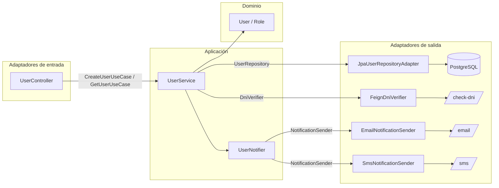

# Capgemini-Test — Gestión de salas y usuarios

API REST en Spring Boot 3.2 / Java 17 que da de alta usuarios en una sala: valida sus datos y su DNI contra
un servicio externo, los guarda en PostgreSQL, los notifica por email o SMS según su rol y devuelve el ID generado.

El enunciado original está en [docs/ENUNCIADO.md](docs/ENUNCIADO.md).

## Puesta en marcha

Requisitos: **Java 17+** y **Docker**. No hace falta Maven instalado: el proyecto trae el wrapper (`mvnw`).

```bash
# 1. Infraestructura: PostgreSQL + MockServer (APIs de DNI, email y SMS)
cd docker && docker compose up -d && cd ..

# 2. Aplicación (http://localhost:8080)
./mvnw spring-boot:run        # Windows: mvnw.cmd spring-boot:run
```

O todo en contenedores, sin Java local: `cd docker && docker compose --profile app up -d --build`
(si el 8080 está ocupado: `APP_PORT=8089 docker compose --profile app up -d --build`).

- Swagger UI: http://localhost:8080/swagger-ui.html
- Health: http://localhost:8080/actuator/health
- Colección de Postman: [postman/capgemini.postman_collection.json](postman/capgemini.postman_collection.json)

## API

| Método | Ruta | Respuesta |
|---|---|---|
| `POST` | `/api/v1/rooms/{roomId}/users` | `201` `{"id": "1"}` + cabecera `Location` |
| `GET` | `/api/v1/rooms/{roomId}/users/{userId}` | `200` con el usuario |

El enunciado trabaja sobre la sala 1 (`/api/v1/rooms/1/users`); la ruta ya admite cualquier sala existente.

```bash
curl -i -X POST localhost:8080/api/v1/rooms/1/users -H 'Content-Type: application/json' \
  -d '{"name":"pablo","email":"email@email.com","phone":"677998899","rol":"admin","dni":"23454234W"}'

curl localhost:8080/api/v1/rooms/1/users/1
```

Todos los errores comparten el formato `{"code": <http>, "message": "<texto>"}`:

| Caso | HTTP | `message` |
|---|---|---|
| Nombre vacío o de más de 6 caracteres | 409 | `error validation userName` |
| Email sin `@` o sin `.`, o ya registrado | 409 | `error validation email` |
| Rol distinto de `admin` / `superadmin` | 409 | `error validation rol` |
| DNI rechazado por el servicio externo, o ya registrado | 409 | `error validation dni` |
| Teléfono vacío o ya registrado | 409 | `error validation phone` |
| Sala o usuario inexistente | 404 | `room 99 not found` / `user 7 not found in room 1` |
| JSON mal formado o ID no numérico | 400 | `malformed request` |
| El servicio de DNI no responde | 503 | `dni service unavailable` |

## Arquitectura

Arquitectura hexagonal (puertos y adaptadores), organizada por contexto de negocio (`user`) con un módulo `shared`:



```
com.capgemini.test.code
├── shared                     # reutilizable por otros contextos (pagos, pedidos...)
│   ├── domain                 # DomainException
│   └── infrastructure         # FeignConfig, GlobalExceptionHandler, NotificationClient
└── user
    ├── domain                 # User, Role, NotificationChannel, excepciones — Java puro
    ├── application            # casos de uso y puertos — Java puro, sin Spring
    └── infrastructure         # REST, JPA, Feign y el ensamblado (UserModuleConfig)
```

### Decisiones de diseño

- **Dominio y aplicación sin Spring.** `User`, `Role` y `UserService` no importan nada del framework.
  `UserService` se crea en `UserModuleConfig` y se prueba con mocks sencillos. JPA y Feign viven solo en los adaptadores.
- **Un `User` inválido no puede existir.** Las reglas se comprueban en el constructor del record; el resto del
  código no vuelve a validar.
- **Comprobaciones de la más barata a la más cara:** formato (memoria), luego sala y email (BD) y por último el
  DNI (red). No se llama al servicio externo con peticiones que se iban a rechazar igualmente.
- **La BD garantiza la unicidad.** La comprobación previa del email da el mensaje correcto en el caso normal. Con dos
  peticiones concurrentes, la restricción `UNIQUE` hace de última barrera y el adaptador traduce su error a
  `409 error validation <campo>`.
- **Patrón Strategy para notificar.** Cada `Role` declara su `NotificationChannel` y cada canal tiene un
  `NotificationSender`. Un canal nuevo (p. ej. push) es una clase nueva, sin tocar el servicio. Si falta la
  estrategia de algún canal, la aplicación no arranca.
- **Notificación best-effort.** Si el usuario ya está guardado y falla el email/SMS, se registra en el log y se devuelve
  igualmente el `201`: el alta es correcta. Para garantizar la entrega, el siguiente paso sería un *outbox* transaccional.
- **409 de negocio frente a 503 técnico.** Un 409 del servicio de DNI es una respuesta de negocio (DNI rechazado →
  409 al cliente). Un timeout o un 5xx es un fallo nuestro (→ 503), no del usuario.
- **El DNI se envía tal cual.** El servicio externo es la fuente de verdad y distingue mayúsculas (`99999999w` se
  rechaza y `99999999W` no). Tampoco se valida la letra en local: el DNI del ejemplo del enunciado (`23454234W`) no
  pasa el algoritmo de la letra y se rechazaría.
- **El email se normaliza a minúsculas**, para que `Email@x.com` y `email@x.com` cuenten como el mismo usuario.
- **IDs como string en JSON** (`"id": "1"`), como pide el contrato. Además evita que un cliente JavaScript pierda
  precisión con IDs `long` por encima de 2^53.

## Problemas del proyecto base y cómo se han resuelto

| Problema | Efecto | Solución |
|---|---|---|
| `DniClient` usa `feign.okhttp.OkHttpClient`, pero `feign-okhttp` no estaba en el `pom.xml` | No compilaba | Se añade la dependencia y OkHttp se activa por configuración. Además es necesaria: el cliente por defecto de Feign no admite `PATCH` |
| `FeignConfig` anotada con `@Configuration` dentro de la interfaz del cliente | Se aplicaba como configuración global a todos los clientes Feign | Se elimina; timeouts y logs van en `application.yml` |
| `V1__init.sql` inserta usuarios sin `dni` ni `phone` (`NOT NULL`) | La migración fallaba y la app no arrancaba | Se corrige la V1 in situ: nunca pudo aplicarse, así que ningún entorno la tiene. Se quitan los usuarios semilla (incumplían las reglas: nombre > 6, rol `USER`) |
| IDs `SERIAL` (int) | El enunciado pide long | `BIGSERIAL` |
| `flyway.baseline-on-migrate: true` | Con una BD ya poblada marcaría la V1 como aplicada sin ejecutarla | Se elimina |
| `postgres:latest` | Hoy es PostgreSQL 18, que cambia la ruta de datos: el contenedor entra en bucle de reinicios | Imagen fijada a `postgres:15-alpine`, la más alta soportada por el Flyway de Boot 3.2. MockServer también fijado (`5.15.0`) |
| `.mvn/wrapper` sin los scripts `mvnw` / `mvnw.cmd` | El wrapper no se podía usar | Se generan |
| `contextLoads()` necesitaba una BD levantada a mano | El test fallaba sin Docker Compose | Sustituido por tests con Testcontainers |
| Petición «sms» de Postman apuntando a `/check-dni` | Colección engañosa | Corregida; se añaden las peticiones de la API |

## Pruebas

```bash
./mvnw test     # unitarias y de slice web: segundos, sin Docker
./mvnw verify   # + integración y aceptación con Testcontainers (requiere Docker)
```

| Nivel | Qué cubre | Herramientas |
|---|---|---|
| Unitarias | Reglas de `User` y `Role`, orquestación de `UserService` (orden de las comprobaciones, qué no se llama cuando algo falla), elección de canal, traducción de errores Feign | JUnit 5, Mockito, AssertJ |
| Slice web | Contrato HTTP: rutas, códigos, cabecera `Location`, formato de errores | `@WebMvcTest` |
| Integración | Adaptador JPA contra PostgreSQL real con el esquema de Flyway, incluida la traducción de restricciones `UNIQUE` | Testcontainers |
| Aceptación | Los requisitos del enunciado en Gherkin (castellano) contra la app completa: verifican en MockServer qué notificaciones se enviaron y cuáles no | Cucumber, Testcontainers (mismo `init.json` que docker-compose) |

El informe de Cucumber queda en `target/cucumber-report.html`.

## Escalabilidad (condiciones opcionales)

- **Otros contextos (pagos, pedidos...):** cada contexto sería un paquete hermano de `user` con su propio
  `domain/application/infrastructure`. Lo transversal (formato de errores, cliente de notificaciones) ya está en `shared`.
- **De una a millones de peticiones:** la aplicación no guarda estado, así que escala en horizontal detrás de un
  balanceador (la imagen Docker está lista). La unicidad la garantiza la BD, no la memoria. Las llamadas externas
  tienen timeouts para que un servicio lento no agote los hilos.

Siguientes pasos que no se han implementado, para no sobredimensionar la prueba:

- Circuit breaker y reintentos sobre el servicio de DNI (Resilience4j).
- Outbox transaccional para entregar las notificaciones de forma garantizada y asíncrona.
- Hilos virtuales (Java 21) y réplicas de lectura para el `GET`.
- Caché de las respuestas de DNI.
- Métricas Micrometer/Prometheus.
