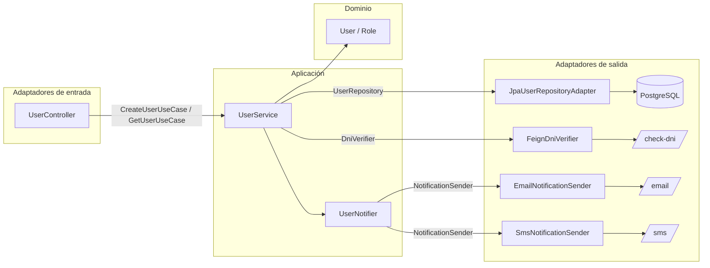

# Capgemini-Test — Gestión de salas y usuarios

API REST en Spring Boot 3.2 / Java 17 que da de alta usuarios en una sala: valida sus datos y su DNI contra
un servicio externo, los guarda en PostgreSQL, los notifica por email o SMS según su rol y devuelve el ID generado.

El enunciado original está en [docs/ENUNCIADO.md](docs/ENUNCIADO.md).

## Puesta en marcha

Requisitos: **Java 17+** y **Docker**. No hace falta Maven instalado: el proyecto trae el wrapper (`mvnw`).

```bash
# 1. Infraestructura: PostgreSQL + MockServer (APIs de DNI, email y SMS)
cd docker && docker compose up -d && cd ..

# 2. Aplicación (http://localhost:8080)
./mvnw spring-boot:run        # Windows: mvnw.cmd spring-boot:run
```

O todo en contenedores, sin Java local: `cd docker && docker compose --profile app up -d --build`
(si el 8080 está ocupado: `APP_PORT=8089 docker compose --profile app up -d --build`).

- Swagger UI: http://localhost:8080/swagger-ui.html
- Health: http://localhost:8080/actuator/health
- Colección de Postman: [postman/capgemini.postman_collection.json](postman/capgemini.postman_collection.json)

## API

| Método | Ruta | Respuesta |
|---|---|---|
| `POST` | `/api/v1/users` | `201` `{"id": "1"}` + cabecera `Location` |
| `GET` | `/api/v1/users/{userId}` | `200` con el usuario |

El cliente no elige sala: el servidor da de alta y busca los usuarios en la sala 1 (propiedad
`app.users.default-room-id`). Un usuario de otra sala no se encuentra (`404`).

```bash
curl -i -X POST localhost:8080/api/v1/users -H 'Content-Type: application/json' \
  -d '{"name":"pablo","email":"email@email.com","phone":"677998899","rol":"admin","dni":"23454234W"}'

curl localhost:8080/api/v1/users/1
```

### Ambigüedad del enunciado: ¿quién elige la sala?

El enunciado dice «guarda un usuario en la sala 1» y «obtiene un usuario dentro de la sala 1», pero también que la
aplicación «debe gestionar salas y usuarios». Admite dos lecturas:

1. **La sala la asigna el servidor:** los usuarios entran siempre en la sala 1 y el cliente no la envía.
2. **La sala es un parámetro** (`/rooms/{roomId}/users`) y la prueba solo usa la sala 1.

Se ha implementado la lectura 1, por ser la más literal: no se añade al contrato nada que no se pida. La sala no
está escrita en el código sino en configuración, y la aplicación no arranca si esa sala no existe. **En un proyecto
real, este requisito se aclararía con negocio antes de implementarlo.** Si la respuesta fuera la lectura 2, el
cambio se limita al controlador y a la firma de los casos de uso.

Todos los errores comparten el formato `{"code": <http>, "message": "<texto>"}`:

| Caso | HTTP | `message` |
|---|---|---|
| Nombre vacío o de más de 6 caracteres | 409 | `error validation userName` |
| Email sin `@` o sin `.`, o ya registrado | 409 | `error validation email` |
| Rol distinto de `admin` / `superadmin` | 409 | `error validation rol` |
| DNI rechazado por el servicio externo, o ya registrado | 409 | `error validation dni` |
| Teléfono vacío o ya registrado | 409 | `error validation phone` |
| Usuario inexistente o de otra sala | 404 | `user 7 not found` |
| JSON mal formado o ID no numérico | 400 | `malformed request` |
| El servicio de DNI no responde | 503 | `dni service unavailable` |

## Arquitectura

Arquitectura hexagonal (puertos y adaptadores), organizada por contexto de negocio (`user`) con un módulo `shared`:



```
com.capgemini.test.code
├── shared                     # reutilizable por otros contextos (pagos, pedidos...)
│   ├── domain                 # DomainException
│   └── infrastructure         # FeignConfig, GlobalExceptionHandler, NotificationClient
└── user
    ├── domain                 # User, Role, NotificationChannel, excepciones — Java puro
    ├── application            # casos de uso y puertos — Java puro, sin Spring
    └── infrastructure         # REST, JPA, Feign y el ensamblado (UserModuleConfig)
```

### Decisiones de diseño

- **Dominio y aplicación sin Spring.** `User`, `Role` y `UserService` no importan nada del framework.
  `UserService` se crea en `UserModuleConfig` y se prueba con mocks sencillos. JPA y Feign viven solo en los adaptadores.
- **Un `User` inválido no puede existir.** Las reglas se comprueban en el constructor del record; el resto del
  código no vuelve a validar.
- **Comprobaciones de la más barata a la más cara:** formato (memoria), luego email (BD) y por último el
  DNI (red). No se llama al servicio externo con peticiones que se iban a rechazar igualmente.
- **La BD garantiza la unicidad.** La comprobación previa del email da el mensaje correcto en el caso normal. Con dos
  peticiones concurrentes, la restricción `UNIQUE` hace de última barrera y el adaptador traduce su error a
  `409 error validation <campo>`.
- **Patrón Strategy para notificar.** Cada `Role` declara su `NotificationChannel` y cada canal tiene un
  `NotificationSender`. Un canal nuevo (p. ej. push) es una clase nueva, sin tocar el servicio. Si falta la
  estrategia de algún canal, la aplicación no arranca.
- **Notificación best-effort.** Si el usuario ya está guardado y falla el email/SMS, se registra en el log y se
  devuelve igualmente el `201`. Ver [Notificaciones: decisión y evolución](#notificaciones-decisión-y-evolución).
- **409 en todas las validaciones, por contrato.** El enunciado fija `409 Conflict` para cualquier fallo de
  validación, y así se ha implementado: el contrato con quien consume la API manda, y un cambio así se acuerda, no se
  impone. En un diseño propio se distinguiría entre `400 Bad Request` / `422 Unprocessable Content` para los datos
  mal formados (nombre demasiado largo, email sin `@`, rol inexistente: el cliente puede corregirlos) y `409` solo
  para los conflictos con el estado del sistema (email o DNI ya registrados). Así, un frontend o un cliente
  automático sabe sin leer el mensaje si debe corregir el formulario o si el recurso ya existe.
- **409 de negocio frente a 503 técnico.** Un 409 del servicio de DNI es una respuesta de negocio (DNI rechazado →
  409 al cliente). Un timeout o un 5xx es un fallo nuestro (→ 503), no del usuario.
- **El DNI se envía tal cual.** El servicio externo es la fuente de verdad y distingue mayúsculas (`99999999w` se
  rechaza y `99999999W` no). Tampoco se valida la letra en local: el DNI del ejemplo del enunciado (`23454234W`) no
  pasa el algoritmo de la letra y se rechazaría.
- **El email se normaliza a minúsculas**, para que `Email@x.com` y `email@x.com` cuenten como el mismo usuario.
- **IDs como string en JSON** (`"id": "1"`), como pide el contrato. Además evita que un cliente JavaScript pierda
  precisión con IDs `long` por encima de 2^53.

### Notificaciones: decisión y evolución

Qué hacer cuando el usuario ya está guardado y falla la notificación es una decisión de negocio: cuánto importa
avisar en el momento frente a cuánto importa poder dar de alta al usuario. Aquí se ha priorizado el alta: que el
proveedor de email/SMS esté caído no debe impedir registrar usuarios.

Alternativas descartadas:

- **Devolver un error.** El usuario ya existe, así que el cliente reintentaría y recibiría `409 email duplicado`. La
  respuesta mentiría sobre el estado real.
- **Deshacer el alta.** Es coherente, pero haría depender el registro de la disponibilidad de un tercero.

La solución actual (síncrona y best-effort) tiene un coste: si el envío falla, la notificación se pierde y solo queda
constancia en el log. Es aceptable para el alcance de esta prueba, no para producción.

**Evolución propuesta: notificaciones asíncronas con patrón outbox.**

1. Al dar de alta, en la **misma transacción** que el `INSERT` del usuario, se guarda una fila en una tabla
   `notification_outbox` (usuario, canal, mensaje, estado `PENDING`, número de intentos, fecha del próximo intento).
   O se guardan los dos o ninguno: no puede haber un usuario sin su notificación pendiente, ni al revés.
2. La petición responde `201` sin esperar al proveedor, así que es más rápida y no le afectan sus caídas.
3. Un proceso en segundo plano (`@Scheduled` o un worker aparte) recoge las filas pendientes, envía y las marca
   como `SENT`. Si falla, incrementa los intentos y reprograma con espera exponencial; superado un máximo, la fila
   pasa a `FAILED` para revisarla o generar una alerta.
4. Con varias réplicas de la aplicación, cada fila se reserva con `SELECT ... FOR UPDATE SKIP LOCKED` para que no
   se envíe dos veces. La entrega es *al menos una vez*: si el proveedor admite una clave de idempotencia, se usa el
   ID de la fila del outbox.

El código ya está preparado: `UserNotifier` es el único punto que habría que cambiar (de «enviar» a «encolar»), y los
`NotificationSender` se reutilizarían tal cual desde el proceso que envía.

## Problemas del proyecto base y cómo se han resuelto

| Problema | Efecto | Solución |
|---|---|---|
| `DniClient` usa `feign.okhttp.OkHttpClient`, pero `feign-okhttp` no estaba en el `pom.xml` | No compilaba | Se añade la dependencia y OkHttp se activa por configuración. Además es necesaria: el cliente por defecto de Feign no admite `PATCH` |
| `FeignConfig` anotada con `@Configuration` dentro de la interfaz del cliente | Se aplicaba como configuración global a todos los clientes Feign | Se elimina; timeouts y logs van en `application.yml` |
| `V1__init.sql` inserta usuarios sin `dni` ni `phone` (`NOT NULL`) | La migración fallaba y la app no arrancaba | Se corrige la V1 in situ: nunca pudo aplicarse, así que ningún entorno la tiene. Se quitan los usuarios semilla (incumplían las reglas: nombre > 6, rol `USER`) |
| IDs `SERIAL` (int) | El enunciado pide long | `BIGSERIAL` |
| `flyway.baseline-on-migrate: true` | Con una BD ya poblada marcaría la V1 como aplicada sin ejecutarla | Se elimina |
| `postgres:latest` | Hoy es PostgreSQL 18, que cambia la ruta de datos: el contenedor entra en bucle de reinicios | Imagen fijada a `postgres:15-alpine`, la más alta soportada por el Flyway de Boot 3.2. MockServer también fijado (`5.15.0`) |
| `.mvn/wrapper` sin los scripts `mvnw` / `mvnw.cmd` | El wrapper no se podía usar | Se generan |
| `contextLoads()` necesitaba una BD levantada a mano | El test fallaba sin Docker Compose | Sustituido por tests con Testcontainers |
| Petición «sms» de Postman apuntando a `/check-dni` | Colección engañosa | Corregida; se añaden las peticiones de la API |

## Pruebas

```bash
./mvnw test     # unitarias y de slice web: segundos, sin Docker
./mvnw verify   # + integración y aceptación con Testcontainers (requiere Docker)
```

| Nivel | Qué cubre | Herramientas |
|---|---|---|
| Unitarias | Reglas de `User` y `Role`, orquestación de `UserService` (orden de las comprobaciones, qué no se llama cuando algo falla), elección de canal, traducción de errores Feign | JUnit 5, Mockito, AssertJ |
| Slice web | Contrato HTTP: rutas, códigos, cabecera `Location`, formato de errores | `@WebMvcTest` |
| Integración | Adaptador JPA contra PostgreSQL real con el esquema de Flyway, incluida la traducción de restricciones `UNIQUE` | Testcontainers |
| Aceptación | Los requisitos del enunciado en Gherkin (castellano) contra la app completa: verifican en MockServer qué notificaciones se enviaron y cuáles no | Cucumber, Testcontainers (mismo `init.json` que docker-compose) |

El informe de Cucumber queda en `target/cucumber-report.html`.

## Escalabilidad (condiciones opcionales)

- **Otros contextos (pagos, pedidos...):** cada contexto sería un paquete hermano de `user` con su propio
  `domain/application/infrastructure`. Lo transversal (formato de errores, cliente de notificaciones) ya está en `shared`.
- **De una a millones de peticiones:** la aplicación no guarda estado, así que escala en horizontal detrás de un
  balanceador (la imagen Docker está lista). La unicidad la garantiza la BD, no la memoria. Las llamadas externas
  tienen timeouts para que un servicio lento no agote los hilos.

Siguientes pasos que no se han implementado, para no sobredimensionar la prueba:

- Circuit breaker y reintentos sobre el servicio de DNI (Resilience4j).
- Outbox transaccional para las notificaciones (diseño descrito arriba).
- Otros documentos de identidad (NIE, pasaporte): un campo de tipo de documento y una normalización por tipo para
  la unicidad. La validación seguiría delegándose en el servicio externo, enviándole el valor original.
- Hilos virtuales (Java 21) y réplicas de lectura para el `GET`.
- Caché de las respuestas de DNI.
- Métricas Micrometer/Prometheus.
